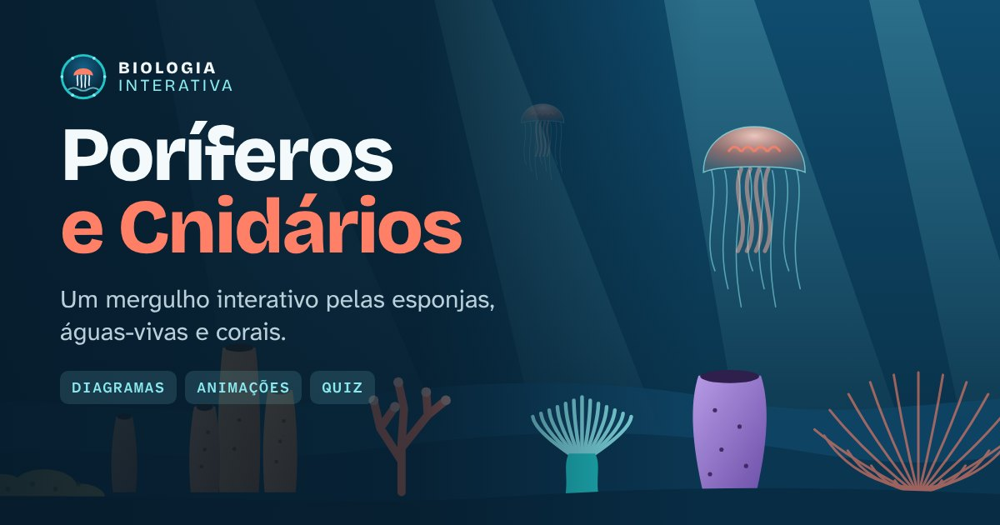

# Biologia Interativa · Poríferos e Cnidários



Site educacional interativo sobre os filos **Porifera** (esponjas) e **Cnidaria** (águas-vivas, corais, anêmonas e hidras), feito para estudantes do Ensino Médio.

## O que tem no site

- **Poríferos:** características, esponja em corte com partes clicáveis, animação da filtração da água, tipos de corpo, reprodução e exemplos.
- **Cnidários:** hidra em corte, disparo do cnidócito, transformação de pólipo em medusa, grupos, ciclo de vida da água-viva e simulação do branqueamento dos corais.
- **Comparação:** poríferos × cnidários lado a lado e o jogo "Encontrar as diferenças".
- **Desafio do Oceano:** quiz com 18 perguntas e explicação em cada resposta.
- **Quem sou eu?:** jogo de classificação em dois modos.
- **Revisão:** glossário com busca e resumo para a prova.

## Como rodar no computador

Precisa do [Node.js](https://nodejs.org) 20.19 ou mais novo.

```bash
npm install
npm run dev
```

Abra o endereço que aparecer no terminal (normalmente `http://localhost:5173`).

## Publicar na Vercel

1. Na Vercel, clique em **Add New → Project** e importe este repositório.
2. A Vercel reconhece o Vite sozinha. Não precisa mudar nenhuma configuração.
3. Clique em **Deploy**.

A imagem de prévia do link (`public/og-image.jpg`) usa o domínio de produção da Vercel automaticamente.

## Versão para apresentar sem internet

```bash
npm run build:single
```

Gera o arquivo `dist-single/index.html` com tudo dentro (textos, fontes e ilustrações). Dá para abrir direto no navegador, mesmo sem internet.

## Onde mudar o conteúdo

Todo o texto fica separado do código, na pasta `src/data`:

| Arquivo | Conteúdo |
| --- | --- |
| `porifera.ts` | Seção de poríferos |
| `cnidaria.ts` | Seção de cnidários |
| `comparison.ts` | Comparação e "Encontrar as diferenças" |
| `quiz.ts` | Perguntas do Desafio do Oceano |
| `games.ts` | Jogo "Quem sou eu?" |
| `glossary.ts` | Glossário |
| `summary.ts` | Resumo para a prova |
| `references.ts` | Referências bibliográficas |

Para revisar todo o conteúdo numa página só, rode `npm run review` e abra `review/conteudo-revisao.html`.

## Tecnologias

React, TypeScript e Vite, com CSS próprio e ícones [Lucide](https://lucide.dev).

## Créditos

- Ilustrações e diagramas: originais do projeto, desenhados em SVG.
- Fontes: Bricolage Grotesque e Atkinson Hyperlegible (licença SIL Open Font License), incluídas no projeto.
- Ícones: Lucide (licença ISC).
- Referências científicas: listadas no rodapé do site e em `src/data/references.ts`.

Conteúdo com finalidade educacional.
